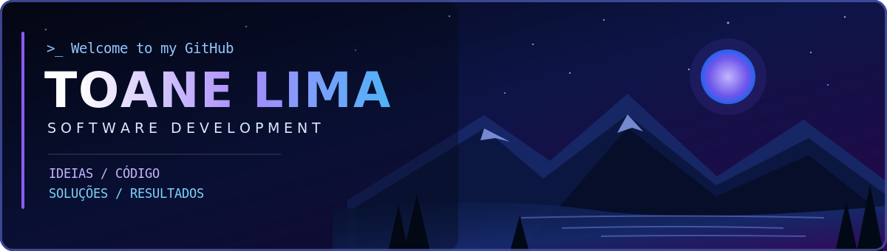

  

    

  
  

  <!-- Adicione aqui seus links reais do LinkedIn e e-mail, caso queira mostrá-los publicamente. -->

 

<h2 align="center">⌘ Tecnologias e Ferramentas</h2>

  
  
  
  
  
  
   
  
  
  
  
  

 

<h2 align="center">◈ Estatísticas do GitHub</h2>

  
   
  

<small>Os gráficos são fornecidos por serviços externos e podem ficar temporariamente indisponíveis. A distribuição de linguagens reflete repositórios, não nível de domínio.</small>

 

<h2 align="center">✦ Sobre mim</h2>

Olá! Sou **Toane Lima**, estudante da área de Tecnologia e interessado em desenvolvimento de software.

Gosto de aprender na prática, resolver problemas e construir projetos que conectem programação, APIs, bancos de dados e automação. Atualmente, venho desenvolvendo meus conhecimentos em **Python, C, C++ e ferramentas de desenvolvimento**.

> Aprendizado contínuo, boas práticas e soluções que fazem a diferença.

 

<h2 align="center">▣ Projetos em Destaque</h2>

| Projeto | Descrição | Tecnologias |
|:--|:--|:--|
| **[Gestão de Atividades](https://github.com/toane-lima/desafio-gestao-ricardo)** | Aplicação de gestão de tarefas, prazos e indicadores de equipe. | Python · FastAPI · PostgreSQL |
| **[API de Usuários](https://github.com/toane-lima/projeto_users_com_api)** | Projeto de criação de API para gerenciamento de usuários. | Python · API |
| **[Monitoramento de Produtos](https://github.com/toane-lima/monitoramento_produtos)** | Monitoramento de preços de itens em supermercados, com coleta automatizada. | Python · Scraping |

  <a href="https://github.com/toane-lima?tab=repositories">Explorar todos os repositórios →</a>

 

<h2 align="center">✧ Interesses e Objetivos</h2>

`💻 Desenvolvimento de software` &nbsp; `🗄️ Bancos de dados e APIs` &nbsp; `⚙️ Automação` &nbsp; `📚 Evolução contínua`

 

*Transformando ideias em código, um projeto de cada vez.*

